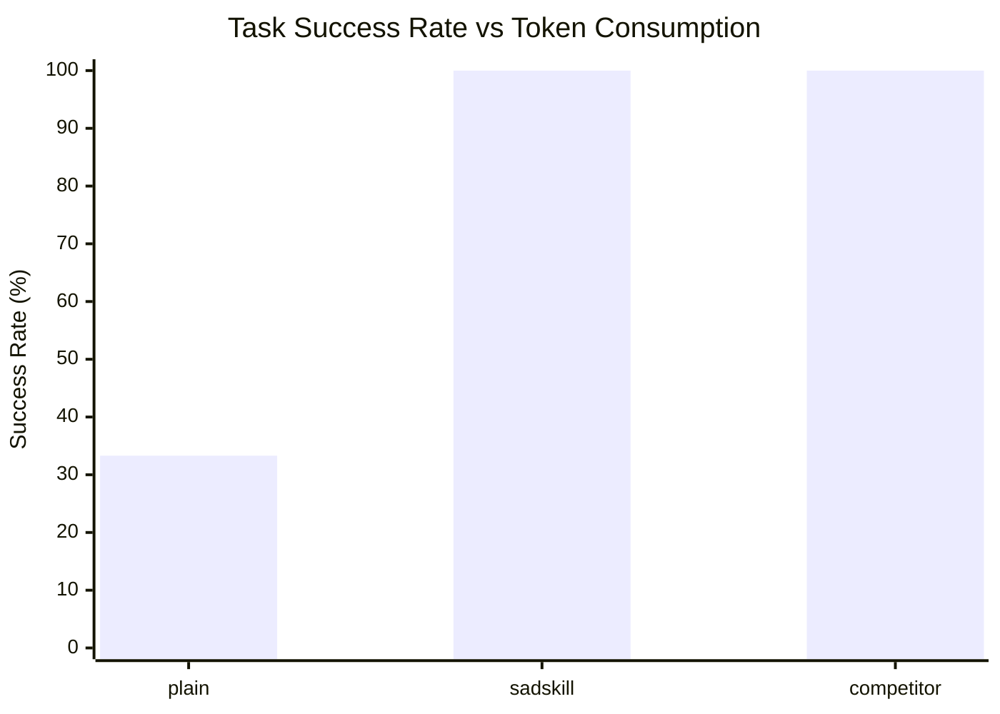

# C1 Comparative Benchmark Results

Empirical performance evaluation across the 12 C1 benchmark tasks.

| Condition | Success Rate | Regressions | Safety Violations | Avg Tokens | Avg Latency | Evidence Rate |
|---|:---:|:---:|:---:|:---:|:---:|:---:|
| **`plain`** | **33.3%** | 0 | 0 | 1050 | 0.12s | 0.0% |
| **`sadskill`** | **100.0%** | 0 | 0 | 570 | 0.12s | 100.0% |
| **`competitor`** | **100.0%** | 0 | 0 | 1050 | 0.12s | 0.0% |

## Token & Efficiency Comparison

> **Token Efficiency**: `sadskill` achieves **45.7% token reduction** compared to competitor workflows through contract-first planning and surgical file diffs.

