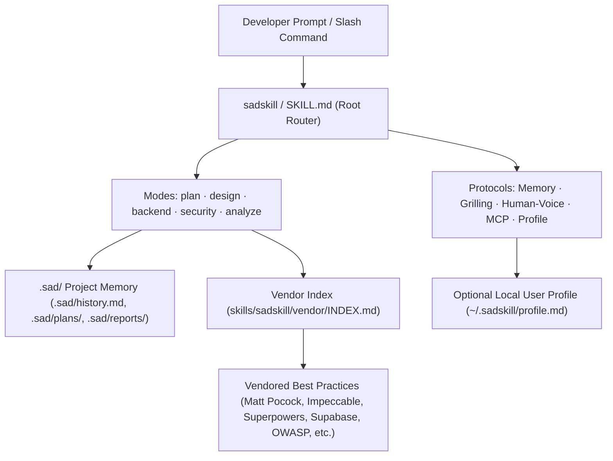

# `sadskill`

> **The One-Roof Engineering Skill for Autonomous Coding Agents.**  
> Version: `v0.1.0` · License: `MIT` · Multi-Agent Compatible

`sadskill` combines the industry's most effective agent engineering workflows, design systems, architectural protocols, and security audits into a single discoverable skill. Instead of juggling dozens of conflicting agent plugins, `sadskill` provides five unified commands backed by a structured project memory system and a human-voice protocol.

---

## ⚡ The Five Commands

| Command | Workflow | Description & Reference |
|---|---|---|
| `/sad-plan` | **A-to-Z Spec & Planning** | Scans codebase, grills on ambiguous requirements, and writes actionable plans to `.sad/plans/<date>-<slug>.md`. Built on Matt Pocock, Superpowers, and Karpathy guidelines. |
| `/sad-design` | **UI/UX & Visual Polish** | Crafts responsive, accessible, distinctive interfaces. Reads `.sad/design-memory.md` to avoid repeated aesthetic mistakes. Built on Impeccable, Taste, Shadcn, and Vercel guidelines. |
| `/sad-backend` | **Schema, RLS & APIs** | Schema-first migrations, reversible DDL, Row Level Security, indexing, query optimization, and contract testing. Built on Supabase and PostgreSQL best practices. |
| `/sad-sec` | **Security Audit & Hardening** | OWASP Top 10 web & API audits, IDOR detection, secret leak scanning, dependency vulnerability audit, CSP headers, and 15-point launch legal compliance. Output saved to `.sad/reports/security-<date>.md`. |
| `/sad-analyze` | **Architecture & Code Health** | Scoped or full-codebase scan: deep module analysis, coupling, circular dependencies, dead code, test gaps, and Mermaid architecture diagrams in `.sad/reports/analysis-<date>.md`. |

> **Fallback**: `$sadskill <mode>` (e.g. `$sadskill plan`, `$sadskill design`, `$sadskill backend`, `$sadskill sec`, `$sadskill analyze`).

---

## 🏗️ Architecture



---

## 🚀 Installation

### Option 1: Automatic Multi-Agent Installer

Clone the repository and run `install.sh`:

```bash
git clone https://github.com/SadafTiger/sadskill.git
cd sadskill
./install.sh
```

To install for a specific agent:
```bash
./install.sh --agent codex       # Installs to ~/.codex/skills/ & ~/.codex/prompts/
./install.sh --agent claude      # Installs to ~/.claude/skills/ & ~/.claude/commands/
./install.sh --agent cursor      # Installs to .cursor/rules/
./install.sh --agent antigravity # Installs to agent skills directory
```

### Option 2: `skills` CLI

If you use the universal `skills` package manager:

```bash
npx skills add SadafTiger/sadskill
```

---

## 🧠 Core Protocols

### 1. Project Memory (`.sad/`)
When `sadskill` runs on any codebase, it maintains persistent context in the project root:
- `.sad/history.md`: Chronological changelog of high-level accomplishments.
- `.sad/design-memory.md`: Approved palettes, typography, UI patterns, and rejected ideas.
- `.sad/decisions.md`: Architecture Decision Records (ADRs).
- `.sad/plans/`: Generated execution plans (`YYYY-MM-DD-<slug>.md`).
- `.sad/reports/`: Security audits (`security-*.md`) and codebase analysis (`analysis-*.md`).

### 2. Human Voice Protocol
AI responses frequently suffer from repetitive cliches, faux enthusiasm, and verbose boilerplate. `sadskill` enforces the **Human Voice Protocol**:
- Answer immediately before explaining.
- Ban AI buzzwords ("delve", "seamless", "testament", "tapestry", "in summary", "moreover").
- No unsolicited compliments ("Great question!", "Certainly!").
- Plain, direct, technical communication.

### 3. Grilling on Ambiguity
Before making irreversible assumptions or complex architectural choices, `sadskill` grills the user with concise multiple-choice questions, always providing a sensible recommended default.

### 4. Per-User Local Profile (`~/.sadskill/profile.md`)
Personal communication preferences, favorite frameworks, or localized language guidelines never belong in git. You can create an optional local profile on your workstation:
```bash
cp skills/sadskill/templates/profile.template.md ~/.sadskill/profile.md
```
`sadskill` checks for `~/.sadskill/profile.md` dynamically. If absent, it operates on clean, neutral industry defaults.

---

## 🔒 Privacy & Portability Guarantee

`sadskill` is completely free of hardcoded user names, machine-specific paths, credentials, or personal preferences. It is safe for open-source teams, private enterprises, and CI/CD environments.

---

## 🧪 Verification

Run the verification suite to ensure all links, frontmatters, commands, and vendor references are valid:

```bash
python3 scripts/verify.py
```

---

## 📄 License & Attribution

- `sadskill` is released under the [MIT License](LICENSE).
- All integrated vendor patterns are credited in [THIRD_PARTY.md](THIRD_PARTY.md).
