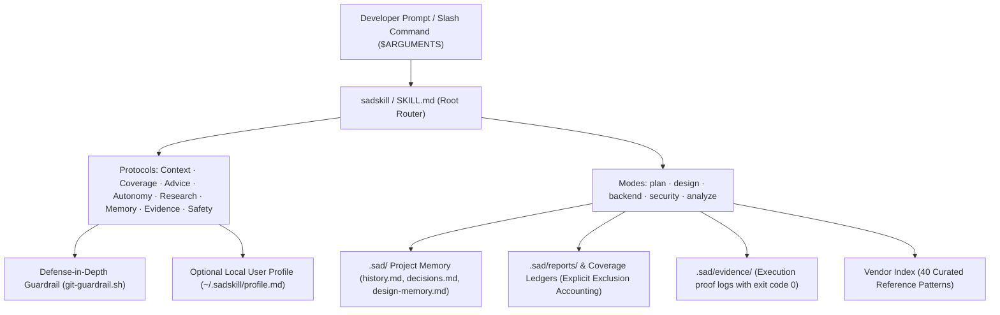

# `sadskill`

> **One engineering workflow. Any coding agent.**  
> *A portable engineering workflow for coding agents that plans proportionally, remembers decisions, verifies outcomes, and reports uncertainty.*  
> Version: `v0.3.0` · License: `MIT` · Multi-Agent Compatible (Claude Code, OpenAI Codex, Cursor, Antigravity, Gemini CLI)

> *"Don't just generate code. Engineer it, verify it, and remember why."*

[](https://github.com/sadafbabu/sadskill/actions/workflows/ci.yml)
[](LICENSE)
[](https://skills.sh)

`sadskill` is an open-source engineering workflow framework for AI coding agents. Instead of juggling conflicting prompt fragments or enduring repetitive trial-and-error cycles, `sadskill` provides **conversation-aware context interpretation, whole-codebase discovery with coverage ledgers, adaptive planning, persistent project memory, defense-in-depth safety guardrails, and proof-grounded verification** across coding agents.

---

## ⚡ Quickstart (Universal via `skills.sh`)

Install `sadskill` into any supported agent using the universal standard:

```bash
npx skills add sadafbabu/sadskill
```

---

## 📊 Why `sadskill`? Core Advantages

| Dimension | Default Plain Coding Agent | Agent Powered by `sadskill` |
|---|---|---|
| **Verification Proof** | Claims *"all tests pass"* blindly without proof | Verifiable terminal proof with exit code `0` recorded in `.sad/evidence/` via trusted recipes |
| **Context & Autonomy** | Loops asking repeated questions or loses intent | **TaskContext Interpretation** & **Autonomous Continuation** without unnecessary approval loops |
| **Codebase Discovery** | Shallow single-file edits with cross-module bugs | **Whole-Codebase Mapping** with explicit Coverage Ledgers (`FULL_COVERAGE` vs `PARTIAL_COVERAGE`) |
| **Token Efficiency** | Speculative trial-and-error editing cycles | **Adaptive Planning** (proportional plans for bugfixes; AST Contracts for architectural features) |
| **Context Retention** | Resets completely across sessions | Persistent `.sad/` memory (`history.md`, `decisions.md`, `design-memory.md`) |
| **Safety Guardrails** | Can run `git reset --hard` or `DROP TABLE` | Executable `git-guardrail.sh` defense filter and Git `pre-push` ref validation |
| **UI/UX Craft Floor** | Generic AI aesthetic (purple gradients, unscaled cards) | **Zero-Lift** hover rule (click compression; drawers/tooltips permitted), preferred 44px targets, 20 UI polish rules |
| **Backend Reliability** | Destructive migrations and permissive queries | Reversible UP/DOWN migrations, database-level RLS, safe `EXPLAIN (BUFFERS)` |

---

## 🧭 The Five Core Workflows

| Command | Workflow | Description & Core Value |
|---|---|---|
| `/sad-plan` | **Adaptive Spec & Planning** | **Tier 1 (Surgical)**: <= 2 files/bugfix/CSS; single-turn lean diff table.<br>**Tier 2 (Architectural)**: Contract-First AST signatures, Mermaid data flows, and failure modes in `.sad/plans/`. |
| `/sad-design` | **UI/UX & Visual Polish** | Distinctive, accessible UI. Enforces the Zero-Lift hover rule (`translateY` card-hover float banned, `scale(0.97)` micro-compression), 20 UI polish tips, and reads `.sad/design-memory.md`. |
| `/sad-backend` | **Schema, RLS & Safe APIs** | Schema-first DDL, reversible UP/DOWN migrations, zero-trust Row Level Security policies, and safe query performance analysis (`EXPLAIN (BUFFERS)`). |
| `/sad-sec` | **Security & Compliance Audit** | Strictly read-only audit: OWASP Top 10 web & API (2025 Standard), secrets exposure, offline-resilient dependency scanning, and 15-point launch legal compliance in `.sad/reports/`. |
| `/sad-analyze` | **Architecture & Code Health** | Scoped (`/sad-analyze <path>`) or whole-codebase scan: coverage accounting, John Ousterhout deep module analysis, coupling, and dead code detection. |

> **Universal Invocation**: If slash commands are not supported in your environment, trigger with `$sadskill <mode>` (e.g. `$sadskill plan`, `$sadskill design`) or via natural language intent.

---

## 🏗️ Architecture



---

## 🚀 Advanced Companion Installer (`install.sh`)

For deep local host integrations (Claude Code commands, Cursor `.mdc` rules, non-destructive backups):

```bash
git clone https://github.com/sadafbabu/sadskill.git
cd sadskill
./install.sh
```

### Agent-Specific Options
```bash
./install.sh --agent codex                     # Installs to ~/.codex/skills/ & ~/.codex/prompts/
./install.sh --agent claude                    # Installs to ~/.claude/skills/ & ~/.claude/commands/
./install.sh --agent cursor --target /path/app # Generates .cursor/rules/sadskill.mdc in target
./install.sh --agent antigravity               # Installs to ~/.gemini/antigravity/skills/
./install.sh --agent all                       # Configures all detected environments
./install.sh --dry-run                         # Previews proposed actions without writing files
```

> **Safe by Design**: `install.sh` uses a transactional manager (`scripts/manifest.py`) to record installed file digests in `~/.sadskill/install-manifest.json` and preserves preexisting files in timestamped `.bak.<timestamp>` archives.

---

## 🛡️ Core Protocols & Security Model

### 1. Verification Evidence Standard (`protocols/evidence.md`)
Tasks conclude with demonstrable terminal verification and machine-readable evidence:
```text
✓ Command: pytest tests/ (exit code 0)
✓ Result: 4 passed, 0 failed (verified in 1.2s)
✓ Evidence: .sad/evidence/20261028-031200-auth-login-fix.json
```

#### Verification Provenance States:
- `REPORTED`: Agent claims execution in conversation.
- `SCHEMA_VALID`: Record schema, project identity, commit, dirty-worktree content digest, timestamp, and contained paths match the current checkout; this still does not prove the claimed command ran.
- `RETESTED`: Independently executed by authorized verifier via trusted recipe registry.
- `CI_CLAIMED`: Evidence contains self-reported CI metadata; no external verification was performed.
- `CI_ATTESTED`: Use only when an independent trusted GitHub check verifies repository, run, workflow, and exact head SHA. The local verifier does not emit this state.

Run `python3 scripts/verify-evidence.py --print-context` to obtain the local `project_id`, `commit_sha`, `worktree_dirty`, and content-bound `worktree_digest` values for a new evidence record. The verifier rejects mismatched or unbound records, including edits made after capture while the checkout remains dirty. It does not accept `--allow-custom-retest`; evidence can select only registered recipes with fixed arguments.

### 2. Defense-in-Depth Safety Guardrails (`protocols/safety.md`)
Safety operates through layered boundaries:
- **Tier 1 (Agent Prompts)**: Strictly forbids destructive operations without explicit confirmation.
- **Tier 2 (Hook Filter)**: `skills/sadskill/hooks/git-guardrail.sh` can filter commands only when an agent host supports, loads, and invokes the registered hook; standalone tests do not prove host activation.
- **Tier 3 (Host Boundaries)**: Sandbox permissions, branch rules, and least privilege.

#### Hook Lifecycle Status:
- `AVAILABLE`: Hook script is installed but not registered.
- `REGISTERED`: A Bash-matching host entry references the hook, but its script is missing or local simulation did not pass.
- `LOCAL_TEST_PASSED`: The hook passed a benign local simulation; this does not prove host activation.
- `HOST_VERIFIED_ACTIVE`: Explicit operator attestation after checking the host; the local diagnostic cannot observe host events.

### 3. Capability Diagnostic Tool (`scripts/doctor.py`)
Run the diagnostic doctor to check local configuration files, Claude hook registration, and benign local simulation. It cannot observe host activation:
```bash
python3 scripts/doctor.py
```

### 4. Workstation Profile Isolation (`~/.sadskill/profile.md`)
Personal communication preferences or private tooling rules live exclusively on your workstation outside git:
```bash
cp skills/sadskill/templates/profile.template.md ~/.sadskill/profile.md
```

---

## 🧪 Verification & Benchmarks

### 1. Independent Evidence Verifier
Validate `.sad/evidence/*.json` records for syntax, strict path containment, and authorized execution:
```bash
python3 scripts/verify-evidence.py
python3 scripts/verify-evidence.py --retest  # Safely re-executes authorized checks with timeout
```

### 2. Contract & Policy Verification Suite
Evaluates specification compliance across planning, design, backend, security, and guardrails:
```bash
python3 benchmarks/runner.py
```

### 3. Behavioral Test Fixtures
Execute behavioral tests on real fixture code:
```bash
# In-memory tenant isolation fixture
python3 benchmarks/fixtures/tenant-isolation/grader.py

# SQLite authorizer simulation of database RLS (not PostgreSQL RLS)
python3 benchmarks/fixtures/real-rls/grader.py
```

---

## 🧹 Safe Uninstallation & Restoration

To cleanly remove `sadskill` and restore original backed-up configurations:

```bash
./uninstall.sh                    # Clean removal of installed files
./uninstall.sh --restore-previous # Restores original pre-install files from backups (preserving user content)
./uninstall.sh --clean-backups    # Removes only sadskill-owned backup archives
./uninstall.sh --purge            # Removes ~/.sadskill user profile directory
```

---

## 🤝 Contributing & Community

We welcome contributions! Please read [`CONTRIBUTING.md`](CONTRIBUTING.md) and [`SECURITY.md`](SECURITY.md) before submitting pull requests.

Run the full verification suite before submitting:
```bash
python3 scripts/verify.py
```

---

## 📄 License & Attribution

- Distributed under the [MIT License](LICENSE).
- Vendored reference guides and community standards are credited in [`THIRD_PARTY.md`](THIRD_PARTY.md) and [`skills/sadskill/vendor/SOURCES.md`](skills/sadskill/vendor/SOURCES.md). Full provenance metadata is tracked in `skills/sadskill/vendor/manifest.json`.
