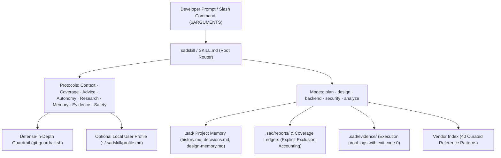

# `sadskill`

> **One engineering workflow. Any coding agent.**  
> *A portable engineering workflow for coding agents that plans proportionally, remembers decisions, verifies outcomes, and reports uncertainty.*  
> Version: `v0.5.0` (release candidate) · License: `MIT` · Multi-Agent Compatible (Claude Code, OpenAI Codex, Cursor, Antigravity, Gemini CLI)

> *"Understand the real engineering task, make the smallest appropriate change, preserve the reasoning, and prove what actually works—across coding agents."*

[](https://github.com/Prarohi/sadskill/actions/workflows/ci.yml)
[](LICENSE)
[](https://skills.sh)

`sadskill` is an open-source **Engineering Confidence Layer** for AI coding agents. Instead of juggling conflicting prompt fragments or enduring repetitive trial-and-error cycles, `sadskill` provides **conversation-aware context interpretation, whole-codebase discovery with coverage ledgers, risk-proportional planning, persistent project memory, defense-in-depth safety guardrails, and proof-grounded verification** across coding agents.

---

## ⚡ Quickstart (Universal via `skills.sh`)

Install `sadskill` into any supported agent using the universal standard:

The current upstream `skills` CLI requires Node.js 22.20 or newer. The companion installer below uses Bash/Python instead.

```bash
npx skills add Prarohi/sadskill
```

---

## 🎯 The Engineering Confidence Layer

Sadskill supplies task-routing instructions, engineering checklists and optional companion tools. Their value depends on the host loading them, the agent applying them, and verification of the resulting work:

- 📖 **[Product Model & Strategy](docs/product/product-model.md)**: The 7 core questions, smallest valuable workflows, and bypass criteria.
- 🔬 **[10 Real-World Engineering Scenarios](docs/product/examples.md)**: Concrete walkthroughs from T0 bugfixes to multi-tenant billing.
- 🔄 **[Auto-Update & Lifecycle Concept](docs/product/auto-update-concept.md)**: Opt-in upgrades, pinning, and instant rollback.
- 📋 **[Product Audit & Ledger](docs/product/audit.md)**: Grounded inspection ledger and architectural findings.
- 🖥️ **[Host Compatibility & Degradation Matrix](docs/compatibility.md)**: Native, Companion, and Prompt-only capability tiers.

---

## 📊 Capabilities and verification limits

Platform-specific guidance loads only for relevant tasks: [Supabase](skills/sadskill/references/supabase.md), [Vercel](skills/sadskill/references/vercel.md), and [Bklit UI charts](skills/sadskill/references/bklit-ui.md). These guides preserve the project's selected stack and authorization boundaries; they do not configure hosted services or install UI dependencies by themselves.

| Capability | Sadskill workflow | Verification limit |
|---|---|---|
| **Verification** | Record commands, exit codes and evidence; retest through trusted recipes | An agent-written record does not prove execution; independent retest or trusted CI is stronger evidence |
| **Context & autonomy** | Interpret current intent and continue authorized work | Prompt guidance depends on host behavior and cannot override user constraints |
| **Codebase discovery** | Map scope with explicit Coverage Ledgers (`FULL_COVERAGE` vs `PARTIAL_COVERAGE`) | A ledger label alone does not prove that source was inspected |
| **Planning** | Scale planning to the task: small fixes through architectural contracts | Token savings and comparative coding success have not been established by paired agent trials |
| **Context retention** | Maintain `.sad/` history and decisions for later reads | Files help only when the next session can access and reads them |
| **Safety guardrails** | Optional command filter and Git `pre-push` ref validation | Requires host activation; lexical filtering is supplemental, not a complete execution boundary |
| **UI/UX guidance** | Zero-Lift hover default, preferred 44px targets, 20 UI polish rules | Project decisions still apply; rendered behavior needs browser/accessibility checks |
| **Backend guidance** | Engine-aware RLS, migration/recovery planning and query analysis | Policies need real-role tests; a reverse schema script does not restore deleted data |

Current deterministic checks and prebuilt fixtures are documented in the [benchmark methodology](docs/benchmark-methodology.md). Real-agent C1 trials remain `NOT_EXECUTED`; no superiority over a plain agent or another skill is claimed.

---

## 🧭 The Five Core Workflows

| Command | Workflow | Description & Core Value |
|---|---|---|
| `/sad-plan` | **Adaptive Spec & Planning** | **Tier 1 (Surgical)**: <= 2 files/bugfix/CSS; single-turn lean diff table.<br>**Tier 2 (Architectural)**: Contract-First AST signatures, Mermaid data flows, and failure modes in `.sad/plans/`. |
| `/sad-design` | **UI/UX & Visual Polish** | Guidance for distinctive, accessible UI: Zero-Lift hover defaults, `scale(0.97)` micro-compression, 20 UI polish tips, and `.sad/design-memory.md`. |
| `/sad-backend` | **Schema, RLS & Safe APIs** | Schema-first DDL, migration/recovery planning, tenant policies, and plan-only `EXPLAIN`; runtime measurements use an authorized disposable database. |
| `/sad-sec` | **Security & Compliance Audit** | Strictly read-only audit guidance: OWASP web/API risks, secrets exposure, dependency scanning and a 15-point launch compliance checklist in `.sad/reports/`. |
| `/sad-analyze` | **Architecture & Code Health** | Scoped (`/sad-analyze <path>`) or whole-codebase scan: coverage accounting, John Ousterhout deep module analysis, coupling, and dead code detection. |

> **Universal Invocation**: If slash commands are not supported in your environment, trigger with `$sadskill <mode>` (e.g. `$sadskill plan`, `$sadskill design`) or via natural language intent.

---

## 🏗️ Architecture



---

## 🚀 Advanced Companion Installer (`install.sh`)

For deep local host integrations (Claude Code commands, Cursor `.mdc` rules, non-destructive backups):

```bash
git clone https://github.com/Prarohi/sadskill.git
cd sadskill
./install.sh
```

### Agent-Specific Options
```bash
./install.sh --agent codex                     # Installs to ~/.codex/skills/ & ~/.codex/prompts/
./install.sh --agent claude                    # Installs to ~/.claude/skills/ & ~/.claude/commands/
./install.sh --agent cursor --target /path/app # Generates .cursor/rules/sadskill.mdc in target
./install.sh --agent antigravity               # Installs to ~/.gemini/antigravity/skills/
./install.sh --agent all                       # Configures all detected environments
./install.sh --dry-run                         # Previews proposed actions without writing files
```

> **Safe by Design**: `install.sh` uses a transactional manager (`scripts/manifest.py`) to record installed file digests in `~/.sadskill/install-manifest.json` and preserves preexisting files in timestamped `.bak.<timestamp>` archives.

> **Sandbox safety**: `sad sandbox -- <command>` requires Linux `bwrap` and refuses to run if unavailable (exit 78). Only `--allow-unsandboxed` permits an explicit unsafe fallback, and `--offline` always refuses that fallback. The sandbox is supplemental isolation, not a guarantee against every exploit.

---

## 🛡️ Core Protocols & Security Model

### 1. Verification Evidence Standard (`protocols/evidence.md`)
Tasks conclude with demonstrable terminal verification and machine-readable evidence:
```text
✓ Command: pytest tests/ (exit code 0)
✓ Result: 4 passed, 0 failed (verified in 1.2s)
✓ Evidence: .sad/evidence/20261028-031200-auth-login-fix.json
```

#### Verification Provenance States:
- `REPORTED`: Agent claims execution in conversation.
- `SCHEMA_VALID`: The record schema, checkout identity, exact commit, worktree digest, timestamp, and contained paths match the current checkout; this still does not prove the claimed command ran.
- `RETESTED`: Independently executed by authorized verifier via trusted recipe registry.
- `CI_CLAIMED`: Evidence contains self-reported CI metadata; no external verification was performed.
- `CI_ATTESTED`: Use only when an independent trusted GitHub check verifies repository, run, workflow, and exact head SHA. The local verifier does not emit this state.

Use the [portable installed helper](skills/sadskill/protocols/evidence.md) with an explicit consumer `--project-root` (or, from the Sadskill source checkout, `python3 scripts/verify-evidence.py --project-root /path/to/consumer --print-context`) to obtain the local `project_id`, `commit_sha`, `worktree_dirty`, and content-bound `worktree_digest` values for a new evidence record. The digest covers tracked and untracked checkout content plus relevant ignored test sources, configs (including Rust toolchain pins), and fixtures outside `.sad/evidence/`; initialized submodule worktrees are included recursively. Standard generated dependency/build directories are excluded unless nested below an explicit test or fixture directory. Gitlinks from both `HEAD` and the index must match `.gitmodules`; snapshots fail closed for mismatches, unmerged index entries, uninitialized submodules, or unsafe paths. It rejects mismatched or unbound records, including edits made after capture while the checkout remains dirty. It does not accept `--allow-custom-retest`; evidence can select only registered recipes with fixed arguments.

### 2. Defense-in-Depth Safety Guardrails (`protocols/safety.md`)
Safety operates through layered boundaries:
- **Tier 1 (Agent Prompts)**: Strictly forbids destructive operations without explicit confirmation.
- **Tier 2 (Hook Filter)**: `skills/sadskill/hooks/git-guardrail.sh` can filter commands only when an agent host supports, loads, and invokes the registered hook; standalone tests do not prove host activation.
- **Tier 3 (Host Boundaries)**: Sandbox permissions, branch rules, and least privilege.

#### Hook Lifecycle Status:
- `AVAILABLE`: Hook script installed on disk, but not registered.
- `REGISTERED`: A Bash-matching `PreToolUse` entry references the hook, but its script is missing or the local simulation did not pass.
- `LOCAL_TEST_PASSED`: Registered hook passed a benign local simulation; this does not prove host activation.
- `HOST_VERIFIED_ACTIVE`: An operator explicitly confirmed host activity with `--confirm-active`; the diagnostic does not observe host events itself.

### 3. Capability Diagnostic Tool (`scripts/doctor.py`)
Run the diagnostic doctor to check local agent configuration files, Claude hook registration, and a benign local hook simulation. It cannot observe whether an agent host loaded or invoked a hook:
```bash
python3 scripts/doctor.py
```

### 4. Workstation Profile Isolation (`~/.sadskill/profile.md`)
Personal communication preferences or private tooling rules live exclusively on your workstation outside git:
```bash
cp skills/sadskill/templates/profile.template.md ~/.sadskill/profile.md
```

---

## 🧪 Verification & Benchmarks

### 1. Independent Evidence Verifier
The following commands run from a Sadskill source checkout. Skill-only installations use the bundled helper described in the [evidence protocol](skills/sadskill/protocols/evidence.md), with the consumer checkout passed as `--project-root`.

Validate `.sad/evidence/*.json` records for syntax, strict path containment, and authorized execution:
```bash
python3 scripts/verify-evidence.py
python3 scripts/verify-evidence.py --retest  # Safely re-executes authorized checks with timeout
```

### 2. Contract & Policy Verification Suite
Evaluates specification compliance across planning, design, backend, security, and guardrails:
```bash
python3 benchmarks/runner.py
```

### 3. Behavioral Test Fixtures
Execute behavioral tests on real fixture code:
```bash
# In-memory tenant isolation fixture
python3 benchmarks/fixtures/tenant-isolation/grader.py

# Database-level Row Level Security fixture
python3 benchmarks/fixtures/real-rls/grader.py
```

---

## 🧹 Safe Uninstallation & Restoration

To cleanly remove `sadskill` and restore original backed-up configurations:

```bash
./uninstall.sh                    # Clean removal of installed files
./uninstall.sh --restore-previous # Restores original pre-install files from backups (preserving user content)
./uninstall.sh --clean-backups    # Removes only sadskill-owned backup archives
./uninstall.sh --purge            # Removes ~/.sadskill user profile directory
```

---

## 🤝 Contributing & Community

We welcome contributions! Please read [`CONTRIBUTING.md`](CONTRIBUTING.md) and [`SECURITY.md`](SECURITY.md) before submitting pull requests.

Run the full verification suite before submitting:
```bash
python3 scripts/verify.py
```

---

## 📄 License & Attribution

- Distributed under the [MIT License](LICENSE).
- Vendored reference guides and community standards are credited in [`THIRD_PARTY.md`](THIRD_PARTY.md) and [`skills/sadskill/vendor/SOURCES.md`](skills/sadskill/vendor/SOURCES.md). Full provenance metadata is tracked in `skills/sadskill/vendor/manifest.json`.
