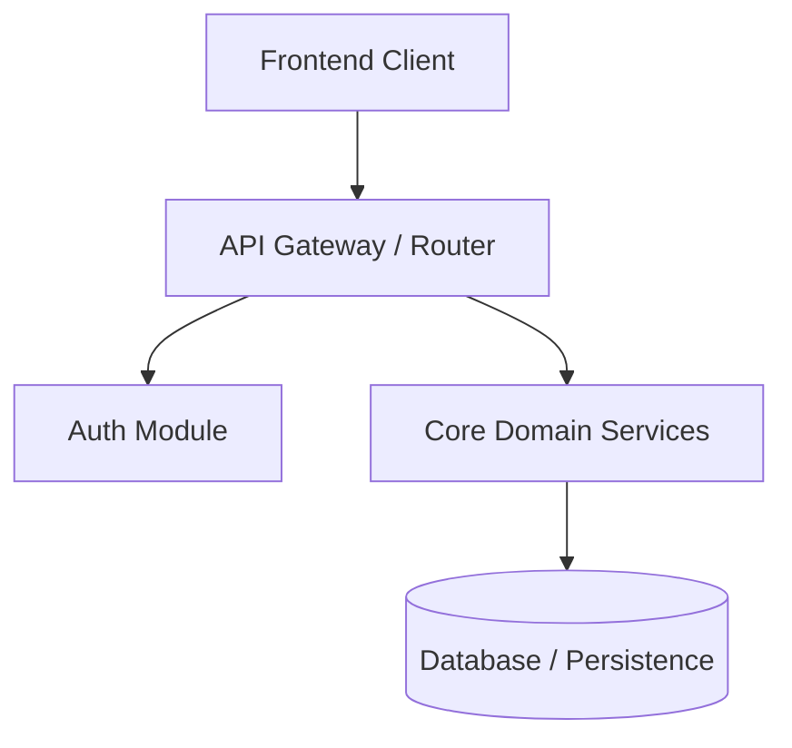

# Codebase Architecture & Health Report: [Project Name]

- **Date**: YYYY-MM-DD
- **Target Mode**: `/sad-analyze`
- **Scope**: Full Codebase / Scoped Path

---

## 1. System Overview & Technology Stack
- **Primary Languages**: TypeScript, Python, etc.
- **Frameworks**: Next.js, FastAPI, etc.
- **Data Layer**: PostgreSQL, Prisma, etc.
- **Entry Points**: `src/index.ts`, `app/page.tsx`

---

## 2. Architecture Diagram


---

## 3. Module Depth & Coupling Assessment
- **Deep Modules (Clean Abstractions)**:
  - `src/lib/crypto`: High internal complexity, clean 3-method interface.
- **Shallow Modules (Refactor Targets)**:
  - `src/utils/helpers.ts`: Pass-through wrapper with no abstraction value.
- **Coupling & God Files**:
  - `src/controllers/main.ts` (1,200 lines, handles 12 distinct routes).

---

## 4. Code Health, Smells & Test Coverage
- **Dead Code Detected**: X unused exports found.
- **Duplicated Logic**: Repeated validation logic across routes.
- **Test Gaps**: Zero integration tests for billing and auth boundaries.

---

## 5. Prioritized Action Matrix (Impact × Effort)

| Priority | Finding / Opportunity | Category | Impact | Effort | Recommended Action |
|---|---|---|---|---|---|
| **P1** | God-file refactor in `main.ts` | Architecture | High | Medium | Run `/sad-plan refactor-main` |
| **P2** | Add integration tests for payments | Testing | High | Low | Run `/sad-plan payment-tests` |
| **P3** | Remove 14 dead utility exports | Cleanliness | Low | Low | Quick cleanup pass |

---

## 6. Substantive Findings (Section 6.4 Schema)

```yaml
id: ANALYZE-001
title: God-file refactor in main controller
severity: high
confidence: confirmed
status: static_only
scope: src/controllers/
references:
  - path: src/controllers/main.ts
    line_start: 1
    line_end: 1200
root_cause: Unseparated routing, validation, business logic and database access in a single module
user_impact: High regression risk, difficult maintenance, slow test iterations
reproduction: Inspect src/controllers/main.ts line count and responsibility mixing
recommended_fix: Split into domain-specific route handlers and service layer
alternatives: Extract shared middleware first
regression_test: Verify all 12 routes respond identically after decoupling
estimated_effort: M
dependencies: []
```

---

## 7. Suggested Next Steps
- Execute `/sad-plan <target>` to address top architectural findings.
- Execute `/sad-sec` if security or auth vulnerabilities were noted.

