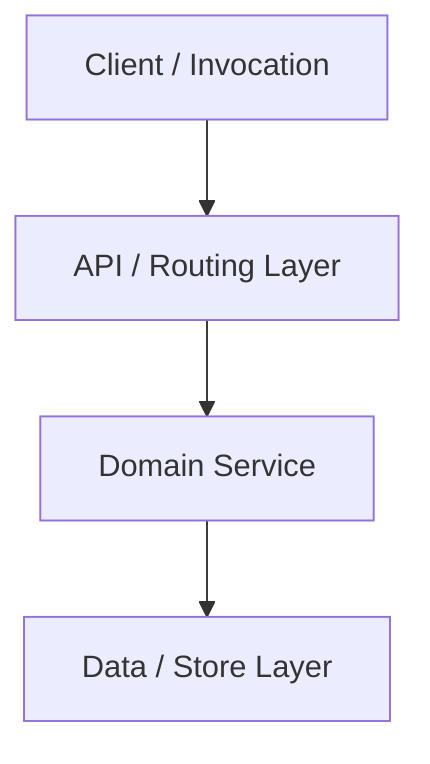

# Implementation Plan: [Feature Title]

- **Date**: YYYY-MM-DD
- **Target File**: `.sad/plans/YYYY-MM-DD-[feature-slug].md`
- **Status**: Draft | Approved | In Progress | Completed

---

## 1. Summary & User Value
[One concise paragraph explaining what is being built, why it is needed, and the expected developer/user outcome.]

---

## 2. Architecture & Data Flow



---

## 3. Discrete Implementation Phases

### Phase 1: [Phase Name]
- **Files Modified/Created**:
  - `path/to/file.ts` (symbols: `FunctionName`, `InterfaceName`)
- **Detailed Changes**:
  - [Step-by-step technical instructions]

### Phase 2: [Phase Name]
- **Files Modified/Created**:
  - `path/to/second_file.ts`
- **Detailed Changes**:
  - [Step-by-step technical instructions]

---

## 4. Edge Cases & Boundary Handling
- [Edge Case 1: Empty input / Null handling]
- [Edge Case 2: Concurrency / Race conditions]
- [Edge Case 3: Network timeout / Failure mode]

---

## 5. Verification Record (Automated Test Plan)
- **Automated Test Commands**:
  ```bash
  npm test
  # or pytest, cargo test, go test
  ```
- **Test Scenarios**:
  1. Happy path: [Expected behavior]
  2. Failure case: [Expected behavior]
  3. Boundary case: [Expected behavior]

---

## 6. Rollback Strategy
- [Specific Git revert command or reversible migration down.sql instructions]
