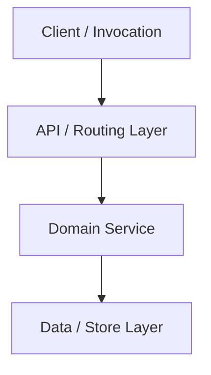

# Implementation Plan: [Feature Title]

- **Date**: YYYY-MM-DD
- **Target File**: `.sad/plans/YYYY-MM-DD-[feature-slug].md`
- **Status**: Draft | Approved | In Progress | Completed

---

## 1. Summary & User Value
[One concise paragraph explaining what is being built, why it is needed, and the expected developer/user outcome.]

---

## 2. Architecture & Data Flow



---

## 3. Contract-First AST Signatures

```typescript
// Pre-declare exact types and function signatures BEFORE implementation
export interface FeatureInput {
  readonly id: string;
  readonly payload: Record<string, unknown>;
}

export interface FeatureOutput {
  readonly success: boolean;
  readonly result?: Record<string, unknown>;
  readonly error?: { code: string; message: string };
}

export function executeFeature(input: FeatureInput): Promise<FeatureOutput>;
```

---

## 4. Discrete Implementation Phases

### Phase 1: [Phase Name]
- **Target File**: `path/to/file.ts`
- **Action**: `CREATE` | `MODIFY` | `DELETE`
- **Target Symbols**: `FunctionName`, `InterfaceName`
- **Contiguous Edits**:
  - [Step-by-step technical instructions]

### Phase 2: [Phase Name]
- **Target File**: `path/to/second_file.ts`
- **Action**: `CREATE` | `MODIFY` | `DELETE`
- **Target Symbols**: `FunctionName`
- **Contiguous Edits**:
  - [Step-by-step technical instructions]

---

## 5. Edge Cases & Boundary Handling
- [Edge Case 1: Empty input / Null handling]
- [Edge Case 2: Concurrency / Race conditions]
- [Edge Case 3: Network timeout / Failure mode]

---

## 6. Verification Record (Automated Test Plan)
- **Automated Test Commands**:
  ```bash
  npm test
  # or pytest, cargo test, go test
  ```
- **Test Scenarios**:
  1. Happy path: [Expected behavior]
  2. Failure case: [Expected behavior]
  3. Boundary case: [Expected behavior]

---

## 7. Rollback Strategy
- [Specific Git revert command or reversible migration down.sql instructions]
